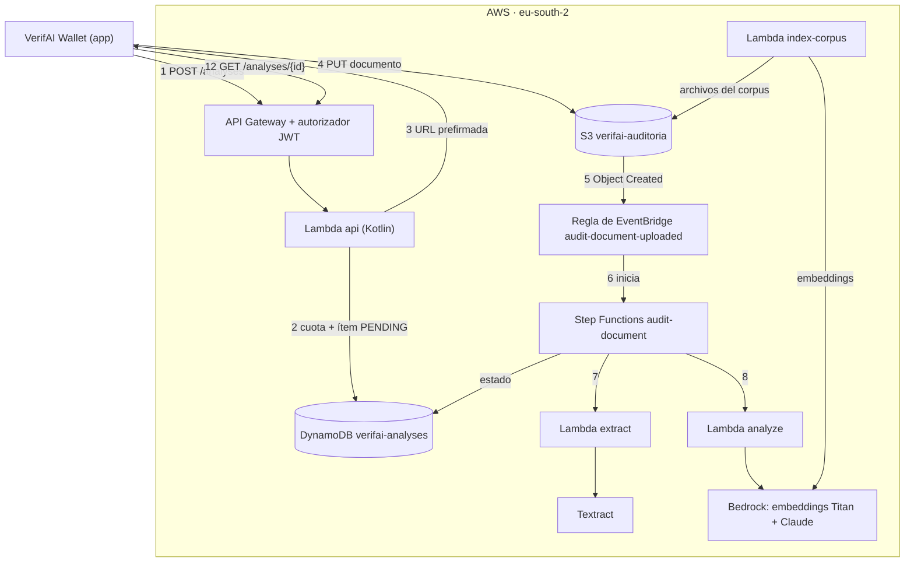
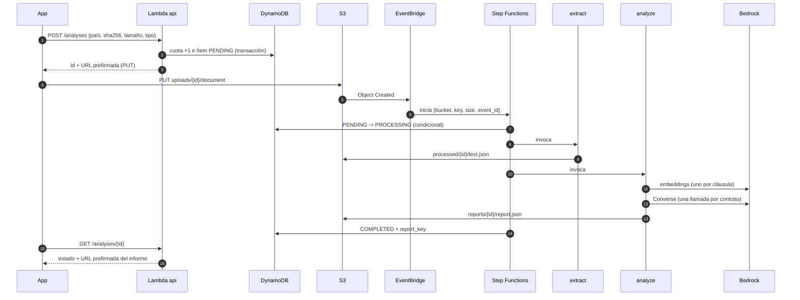

# VerifAI · Subsistema de auditoría legal con IA

Diseño técnico, configuración y guía de despliegue del subsistema que revisa un contrato con IA antes de que el usuario lo firme en la wallet de VerifAI.

| | |
|---|---|
| Región de AWS | `eu-south-2` (Europa, España) |
| Estado | Piloto. La conexión S3 → EventBridge → Step Functions → DynamoDB está confirmada de punta a punta; el código de las Lambdas está escrito y probado en local; faltan desplegar las Lambdas, configurar Bedrock y cargar el corpus |
| Última actualización | 7 de noviembre de 2026 |

> Convención: el código, los nombres de recursos, las variables y los campos van en inglés; las explicaciones, en español.

## Contenido

1. Objetivos
2. Arquitectura y nombres
3. Flujo completo
4. Guía de despliegue paso a paso
5. Metodología
6. Modelo de datos
7. Referencia de configuración
8. Pruebas y códigos de error
9. Costos y rendimiento
10. Seguridad y privacidad
11. Limitaciones y siguientes pasos

---

## 1. Objetivos

1. **Advertir al usuario antes de firmar.** Señalar las cláusulas abusivas o contrarias a la ley de su país, explicarlas en lenguaje sencillo y dejar que el usuario decida si firma.
2. **Respaldar cada advertencia en la ley.** Cada advertencia cita artículos recuperados de un corpus legal curado y versionado. Las citas que el modelo invente se descartan.
3. **Proteger los datos personales.** El modelo de lenguaje nunca ve el documento original: primero se reemplazan los datos personales por marcas, los archivos subidos son temporales y el informe no contiene datos personales.
4. **Mantener costos bajos y predecibles.** Una llamada al modelo por contrato, un índice vectorial guardado como archivos en S3 y ninguna infraestructura encendida permanentemente.
5. **Soportar varias jurisdicciones.** Colombia, España (con la Unión Europea como capa padre) y cobertura parcial (solo UE) para otros Estados miembros.

**Fuera de alcance:** esto no es asesoría jurídica ni reemplaza a un abogado. Cada informe lleva el código `NOT_LEGAL_ADVICE` y la app debe mostrar el aviso correspondiente.

---

## 2. Arquitectura y nombres



### Recursos

| Recurso | Nombre | Para qué sirve |
|---|---|---|
| Bucket de S3 | `verifai-auditoria` | Documentos, texto intermedio, informes y corpus legal |
| Tabla de DynamoDB | `verifai-analyses` | Un ítem por análisis, con su estado |
| Regla de EventBridge (bus `default`) | `audit-document-uploaded` | Inicia el flujo cuando llega un documento |
| Cola de SQS | `audit-eventbridge-dlq` | Eventos que EventBridge no pudo entregar |
| Máquina de estados de Step Functions (Standard) | `audit-document` | Orquesta la auditoría |
| Lambda | `api` (Kotlin, ya existe) | Crea análisis, entrega URLs de subida, devuelve estado e informe |
| Lambda | `extract` (Python) | Valida el archivo, extrae el texto, seudonimiza y divide en cláusulas |
| Lambda | `analyze` (Python) | Búsqueda híbrida de artículos y análisis con Claude |
| Lambda | `index-corpus` (Python) | Construye una versión de una capa del corpus (embeddings + índice de palabras) |
| Modelo de Bedrock | Titan Text Embeddings V2 (`amazon.titan-embed-text-v2:0`) | Embeddings del corpus y de las cláusulas |
| Modelo de Bedrock | Claude Sonnet, mediante un perfil de inferencia europeo | Análisis de las cláusulas |

### Estructura del bucket

```
verifai-auditoria/
├── uploads/{analysis_id}/document        archivo del usuario (temporal, se borra a 1 día)
├── processed/{analysis_id}/text.json     cláusulas seudonimizadas (temporal, se borra a 1 día)
├── reports/{analysis_id}/report.json     informe final
├── corpus-source/{CODE}/{version}/       textos legales que sube el equipo (.txt + .json)
├── corpus-cache/{sha256}.npy             caché de embeddings por documento fuente
└── corpus/
    ├── manifest.json                     capas, padres y versión activa de cada una
    └── {CODE}/{version}/
        ├── meta.json
        ├── chunks.jsonl
        ├── index.npy
        └── lexical.json
```

### Código

```
lambdas/
├── extract/app.py         Lambda extract
├── analyze/app.py         Lambda analyze
├── index-corpus/app.py    Lambda index-corpus
├── shared/lexical.py      tokenizador y BM25, compartido por analyze e index-corpus
├── tests/e2e_test.py      prueba local de punta a punta
├── build.sh               genera los .zip para Lambda
└── build/                 extract.zip, analyze.zip, index-corpus.zip
```

---

## 3. Flujo completo

| Paso | Qué ocurre | Componente |
|---|---|---|
| 1 | La app pide un análisis con su JWT, el país y el SHA-256, tamaño y tipo del archivo | API Gateway → Lambda `api` |
| 2 | `api` valida el país, descuenta la cuota diaria y crea el ítem en estado `PENDING`, en una sola transacción | Lambda `api` + DynamoDB |
| 3 | `api` devuelve una URL prefirmada de subida (5 minutos), atada al SHA-256 y al tipo | Lambda `api` |
| 4 | La app sube el archivo directamente a `uploads/{analysis_id}/document` | S3 |
| 5 | S3 publica `Object Created` en EventBridge; la regla acepta `uploads/*/document` con tamaño mayor que 0 | EventBridge |
| 6 | La regla inicia `audit-document` con `{bucket, key, size, event_id}` | Step Functions |
| 7 | `MarkProcessing` cambia el ítem de `PENDING` a `PROCESSING`; si no estaba `PENDING` (evento duplicado o análisis inexistente), termina en `AlreadyProcessed` | Step Functions → DynamoDB |
| 8 | `extract` valida, extrae, seudonimiza y divide en cláusulas → `processed/{id}/text.json` | Lambda `extract` |
| 9 | `analyze` resuelve las capas del corpus según el país (CO → CO; ES → ES + EU; otro país de la UE → EU) | Lambda `analyze` |
| 10 | Para cada cláusula: referencias explícitas + búsqueda vectorial + BM25, combinadas por capa | Lambda `analyze` + embeddings de Bedrock |
| 11 | Una llamada a Claude por contrato; se verifican las citas → `reports/{id}/report.json` | Lambda `analyze` + Bedrock |
| 12 | `MarkCompleted` escribe `COMPLETED`, `report_key` y `corpus_version` (o `MarkFailed` escribe `FAILED` y `error_message`) | Step Functions → DynamoDB |
| 13 | La app consulta el estado y descarga el informe con una URL prefirmada | Lambda `api` |



---

## 4. Guía de despliegue paso a paso

Todo se hace en la consola web de AWS. Antes de cada fase, comprueba arriba a la derecha que la región sea **Europe (Spain) · eu-south-2**: los recursos son por región y no se ven desde otra.

Las etiquetas de los botones van en inglés; si tu consola está en español, el texto puede variar un poco.

### Estado de partida

| Componente | Estado |
|---|---|
| Bucket `verifai-auditoria` con EventBridge activado | ✅ Hecho |
| Regla `audit-document-uploaded` | ✅ Hecha y probada |
| Máquina `audit-document` | ✅ Hecha y probada |
| Tabla `verifai-analyses` | ✅ Hecha |
| Fases 1 a 8 de esta guía | ☐ Pendientes |

### Fase 1 · Habilitar los modelos en Bedrock

**1.1 Acceso a los modelos**

1. Abre **Amazon Bedrock**.
2. En el menú izquierdo, entra en **Model catalog**.
3. Busca **Titan Text Embeddings V2** (de Amazon) y ábrelo. Si aparece un botón para solicitar o habilitar el acceso, úsalo.
4. Busca **Claude Sonnet** (de Anthropic) en su versión más reciente y haz lo mismo. Anthropic pide **una sola vez** un formulario con el caso de uso: descríbelo como "revisión de contratos para advertir cláusulas abusivas a consumidores antes de firmar".
5. En consolas recientes, muchos modelos se habilitan automáticamente al primer uso. Si no ves botón de acceso, sigue al paso 1.2.

**1.2 Copiar el ID del perfil de inferencia de Claude**

1. En el menú izquierdo de Bedrock, entra en **Cross-region inference** (en algunas versiones de la consola se llama **Inference profiles**).
2. Busca el perfil **EU** del modelo de Claude Sonnet que habilitaste.
3. Copia su **Inference profile ID**. Empieza por `eu.`. Guárdalo: es el valor de la variable `MODEL_ID` de la Lambda `analyze` (Fase 4).
4. Revisa en el detalle del perfil qué regiones aparecen como origen. Si `eu-south-2` **no** está, anota una que sí esté (por ejemplo `eu-central-1`): será el valor de `BEDROCK_REGION` en `analyze` e `index-corpus`. Los datos siguen procesándose dentro de la UE.

> No escribas el ID de memoria: cópialo de la consola. Un ID mal escrito produce `ValidationException` o `AccessDeniedException`.

**1.3 Probar en el Playground**

1. En Bedrock, abre **Playgrounds → Chat / Text**.
2. Elige el mismo modelo o perfil de Claude y escribe un mensaje cualquiera.
3. Si responde, tienes acceso. Si muestra un error de acceso, vuelve al paso 1.1.

**1.4 Dejar el registro de invocaciones apagado**

En **Bedrock → Settings**, comprueba que **Model invocation logging** esté desactivado. Si estuviera activo, guardaría el texto de los contratos en los logs.

### Fase 2 · Ajustes de S3 y DynamoDB

**2.1 Borrado automático de archivos temporales**

1. **S3 → Buckets → `verifai-auditoria` → pestaña Management → Create lifecycle rule**.
2. **Lifecycle rule name:** `delete-uploads-after-1-day`.
3. **Choose a rule scope:** **Limit the scope of this rule using one or more filters** → **Prefix:** `uploads/`.
4. **Lifecycle rule actions:** marca **Expire current versions of objects** → **Days after object creation:** `1`. Si el bucket tiene versionado, marca también **Permanently delete noncurrent versions of objects** → `1`.
5. **Create rule**.
6. Repite con el nombre `delete-processed-after-1-day` y el prefijo `processed/`.

> Nunca apliques una regla de borrado a `corpus/`, `corpus-source/`, `corpus-cache/` ni al bucket completo.

**2.2 TTL en la tabla**

1. **DynamoDB → Tables → `verifai-analyses` → pestaña Additional settings**.
2. En **Time to Live (TTL)**, **Turn on**.
3. **TTL attribute name:** `ttl` → **Turn on TTL**.

### Fase 3 · Generar los paquetes de las Lambdas

Los paquetes ya están generados para **Python 3.13** en `lambdas/build/` y para **Python 3.14** en `lambdas/build-python3.14/`. **El zip debe coincidir con el runtime de la Lambda**: numpy va compilado para una versión concreta de Python, y si no coincide la Lambda falla con `Runtime.ImportModuleError: Error importing numpy`. Si cambias el código, regenéralos desde la carpeta que contiene `lambdas/`, indicando la versión del runtime:

```bash
./lambdas/build.sh 3.13
```

| Paquete | Contiene | Tamaño |
|---|---|---|
| `extract.zip` | `app.py` + `pypdf` | ~0.5 MB |
| `analyze.zip` | `app.py` + `lexical.py` + `numpy` + `snowballstemmer` | ~17 MB |
| `index-corpus.zip` | `app.py` + `lexical.py` + `numpy` + `snowballstemmer` | ~16 MB |

### Fase 4 · Crear y configurar las tres Lambdas

Repite esta fase para `extract`, `analyze` e `index-corpus`. Los valores de cada una están en las tablas del final de la fase.

**4.1 Crear la función**

1. **Lambda → Functions → Create function**.
2. **Author from scratch**.
3. **Function name:** `extract` (luego `analyze` e `index-corpus`).
4. **Runtime:** Python 3.13.
5. **Architecture:** **x86_64**. Es obligatorio: numpy viene compilado para esa arquitectura.
6. **Permissions:** deja **Create a new role with basic Lambda permissions**. Crea un rol que solo puede escribir logs; los demás permisos se agregan en el paso 4.6.
7. **Create function**.

Si `extract` y `analyze` ya existían vacías, ábrelas y continúa desde el paso 4.2.

**4.2 Subir el código**

1. En la función, pestaña **Code**.
2. **Upload from → .zip file → Upload**, elige el zip correspondiente de `lambdas/build/` → **Save**.
3. Para `analyze` e `index-corpus`, la consola dirá que el paquete es demasiado grande para el editor en línea. Es normal: el código se subió bien.

**4.3 Cambiar el handler**

1. En la misma pestaña **Code**, baja hasta **Runtime settings → Edit**.
2. **Handler:** `app.lambda_handler`.
3. **Save**.

> Sin este cambio, la función busca `lambda_function.lambda_handler` y falla con `Runtime.ImportModuleError`.

**4.4 Memoria, timeout y almacenamiento**

1. Pestaña **Configuration → General configuration → Edit**.
2. Pon **Memory**, **Ephemeral storage** y **Timeout** según la tabla.
3. **Save**.

| | `extract` | `analyze` | `index-corpus` |
|---|---|---|---|
| Memory | 1024 MB | 2048 MB | 2048 MB |
| Ephemeral storage | 512 MB | 2048 MB | 512 MB |
| Timeout | 4 min 0 s | 14 min 0 s | 15 min 0 s |

**4.5 Variables de entorno**

1. Pestaña **Configuration → Environment variables → Edit → Add environment variable**.
2. Agrega las de la tabla → **Save**.

| Lambda | Variable | Valor |
|---|---|---|
| `extract` | `ANALYSES_TABLE` | `verifai-analyses` |
| `extract` | `REQUIRE_CHECKSUM` | `false` mientras pruebas desde la consola; `true` cuando las subidas vengan de la app |
| `extract` | `TEXTRACT_REGION` | Solo si Textract no está disponible en `eu-south-2`: una región de la UE donde sí lo esté |
| `analyze` | `MODEL_ID` | El **Inference profile ID** copiado en el paso 1.2 |
| `analyze` | `BEDROCK_REGION` | Solo si `eu-south-2` no es región de origen del perfil (paso 1.2) |
| `index-corpus` | `BUCKET` | `verifai-auditoria` |
| `index-corpus` | `BEDROCK_REGION` | El mismo valor que en `analyze`, si lo usaste |

Las demás variables tienen valores por defecto (sección 7.2).

**4.6 Permisos**

1. Pestaña **Configuration → Permissions**. En **Execution role**, haz clic en el nombre del rol: se abre IAM.
2. **Add permissions → Create inline policy**.
3. Cambia el editor a **JSON**, borra el contenido y pega la política de esa Lambda (sección 7.3).
4. **Next** → **Policy name:** `extract-access`, `analyze-access` o `index-corpus-access` → **Create policy**.

**4.7 Comprobar el rol de la máquina de estados**

1. **Step Functions → State machines → `audit-document` → pestaña Details** → haz clic en el **IAM role ARN**.
2. Revisa que tenga `lambda:InvokeFunction` sobre `extract` y `analyze`, y `dynamodb:UpdateItem` sobre `verifai-analyses`.
3. Si falta algo, agrega una política en línea igual que en el paso 4.6:

```json
{
  "Version": "2012-10-17",
  "Statement": [
    {
      "Effect": "Allow",
      "Action": "lambda:InvokeFunction",
      "Resource": [
        "arn:aws:lambda:eu-south-2:*:function:extract",
        "arn:aws:lambda:eu-south-2:*:function:extract:*",
        "arn:aws:lambda:eu-south-2:*:function:analyze",
        "arn:aws:lambda:eu-south-2:*:function:analyze:*"
      ]
    },
    {
      "Effect": "Allow",
      "Action": "dynamodb:UpdateItem",
      "Resource": "arn:aws:dynamodb:eu-south-2:*:table/verifai-analyses"
    }
  ]
}
```

### Fase 5 · Preparar los textos del corpus

**5.1 Obtener los textos**

| Capa | Norma | Fuente oficial |
|---|---|---|
| `CO` | Ley 1480 de 2011 (Estatuto del Consumidor) | http://www.secretariasenado.gov.co/senado/basedoc/ley_1480_2011.html |
| `CO` | Código Sustantivo del Trabajo | http://www.secretariasenado.gov.co/senado/basedoc/codigo_sustantivo_trabajo.html |
| `CO` | Ley 820 de 2003 (arrendamiento de vivienda urbana) | http://www.secretariasenado.gov.co/senado/basedoc/ley_0820_2003.html |
| `EU` | Directiva 93/13/CEE (cláusulas abusivas) | https://eur-lex.europa.eu/legal-content/ES/TXT/?uri=CELEX:31993L0013 |
| `EU` | Directiva 2011/83/UE (derechos de los consumidores) | https://eur-lex.europa.eu/legal-content/ES/TXT/?uri=CELEX:32011L0083 |
| `EU` | Reglamento (UE) 2016/679 (RGPD) | https://eur-lex.europa.eu/legal-content/ES/TXT/?uri=CELEX:32016R0679 |
| `ES` | RDL 1/2007 (LGDCU) | https://www.boe.es/buscar/act.php?id=BOE-A-2007-20555 |
| `ES` | Ley 29/1994 (LAU) | https://www.boe.es/buscar/act.php?id=BOE-A-1994-26003 |
| `ES` | RDL 2/2015 (Estatuto de los Trabajadores) | https://www.boe.es/buscar/act.php?id=BOE-A-2015-11430 |
| `ES` | Ley 7/1998 (condiciones generales de la contratación) | https://www.boe.es/buscar/act.php?id=BOE-A-1998-8789 |

Para cada norma:

1. Abre la página oficial y copia el texto completo de la norma.
2. Pégalo en un editor de texto plano y guárdalo como `.txt` con codificación **UTF-8**.
3. Comprueba que **cada artículo empiece en su propia línea**, con el formato `ARTÍCULO 24.`, `Artículo 9.` o `ARTÍCULO 1o.` (así `index-corpus` divide por artículo).
4. Borra las **notas del editor**, la jurisprudencia de vigencia y los enlaces que algunas páginas intercalan entre artículos. Si se quedan, ensucian los fragmentos y la búsqueda.
5. Usa nombres de archivo sin espacios ni tildes, por ejemplo `ley-820-2003.txt`.

**5.2 Crear el archivo de metadatos de cada norma**

Junto a cada `.txt`, un `.json` con el mismo nombre. Por ejemplo, `ley-820-2003.json`:

```json
{
  "norm": "Ley 820 de 2003",
  "type": "law",
  "url": "http://www.secretariasenado.gov.co/senado/basedoc/ley_0820_2003.html",
  "derogated_articles": []
}
```

| Campo | Obligatorio | Valores |
|---|---|---|
| `norm` | Sí | Nombre que aparecerá en las citas del informe |
| `type` | No | `law` (se divide por artículo; es el valor por defecto) o `case_law` (jurisprudencia: bloques de unas 400 palabras) |
| `url` | No | Fuente oficial, que se muestra en el informe |
| `derogated_articles` | No | Números de artículos que deben excluirse, por ejemplo `["5", "17"]` |

**5.3 Subirlos a S3**

1. **S3 → `verifai-auditoria` → Create folder** → `corpus-source` → entra → **Create folder** → `CO` → entra → **Create folder** → `2026-11`.
2. Dentro de `corpus-source/CO/2026-11/`, **Upload** con los `.txt` y `.json` de Colombia.
3. Repite para `corpus-source/EU/2026-11/` y `corpus-source/ES/2026-11/`.

Resultado esperado:

```
corpus-source/
├── CO/2026-11/  ley-1480-2011.txt/.json, cst.txt/.json, ley-820-2003.txt/.json
├── EU/2026-11/  directiva-93-13.txt/.json, directiva-2011-83.txt/.json, rgpd.txt/.json
└── ES/2026-11/  lgdcu.txt/.json, lau.txt/.json, estatuto-trabajadores.txt/.json, ley-7-1998.txt/.json
```

### Fase 6 · Indexar y activar el corpus

Se hace desde la consola de Lambda con eventos de prueba. **Indexa primero las capas padre**: `EU` antes que `ES`.

1. **Lambda → `index-corpus` → pestaña Test**.
2. **Create new event** → **Event name:** `index-co` → en **Event JSON** pega:

```json
{"code": "CO", "version": "2026-11", "activate": true}
```

3. **Save** → **Test**. Espera el resultado (segundos con estas leyes).
4. Repite con dos eventos nuevos:

`index-eu`:

```json
{"code": "EU", "version": "2026-11", "activate": true}
```

`index-es`:

```json
{"code": "ES", "version": "2026-11", "parent": "EU", "activate": true}
```

**Respuesta esperada** (los números dependen de los textos):

```json
{
  "code": "CO",
  "version": "2026-11",
  "documents": 3,
  "chunks": 650,
  "embedded_now": 650,
  "from_cache": 0,
  "excluded_derogated": [],
  "review_possible_derogation": ["CO-cst-art13"],
  "activated": true
}
```

- `review_possible_derogation`: fragmentos cuyo inicio menciona "derogado". Revísalos y, si corresponde, agrega su número a `derogated_articles` y vuelve a ejecutar. Solo se recalculan los documentos que cambiaron.
- `TimeBudgetExceeded`: el corpus era demasiado grande para una ejecución. Vuelve a pulsar **Test**: continúa desde la caché.

**Comprobar el resultado en S3:**

- `corpus/manifest.json` existe y tiene `CO`, `EU` y `ES` con `active_version: "2026-11"`, y `ES` con `parent: "EU"`.
- `corpus/CO/2026-11/` tiene `meta.json`, `chunks.jsonl`, `index.npy` y `lexical.json`.
- Descarga `chunks.jsonl` y revisa que cada línea sea un artículo completo y limpio.

**Actualizar o revertir una versión más adelante:**

- Nueva versión de una ley: súbela a `corpus-source/CO/2026-12/` (con el resto de normas de esa capa) y ejecuta `{"code": "CO", "version": "2026-12", "activate": true}`.
- Para indexar sin activar, omite `"activate"`.
- Para volver atrás, edita `corpus/manifest.json` y pon el `active_version` anterior.

### Fase 7 · Revisar la regla de EventBridge

1. **EventBridge → Rules → `audit-document-uploaded` → Edit**.
2. En el paso del patrón, confirma que sea este (acepta solo `uploads/*/document` con contenido):

```json
{
  "source": ["aws.s3"],
  "detail-type": ["Object Created"],
  "detail": {
    "bucket": { "name": ["verifai-auditoria"] },
    "object": {
      "key": [{ "wildcard": "uploads/*/document" }],
      "size": [{ "numeric": [">", 0] }]
    }
  }
}
```

3. Confirma que el destino sea la máquina `audit-document` y que conserve el input transformer (sección 7.5).

### Fase 8 · Prueba completa

**8.1 Crear un análisis de prueba**

1. **DynamoDB → Tables → `verifai-analyses` → Explore table items → Create item**.
2. Cambia a **JSON view** y desactiva **View DynamoDB JSON**.
3. Pega este ítem (para un documento de España, usa `"country": "ES"`):

```json
{
  "id": "11111111-2222-3333-4444-555555555555",
  "status": "PENDING",
  "country": "CO",
  "document_key": "uploads/11111111-2222-3333-4444-555555555555/document",
  "content_type": "application/pdf",
  "created_at": "2026-11-07T10:00:00+00:00",
  "day": "2026-11-07"
}
```

4. **Create item**.

**8.2 Preparar y subir el contrato**

1. Usa un contrato real en PDF con texto (no escaneado), por ejemplo un contrato de arrendamiento.
2. En tu computador, crea la estructura `uploads/11111111-2222-3333-4444-555555555555/` y copia el PDF dentro con el nombre exacto `document`, **sin extensión**. En Mac es más seguro desde la terminal, en la carpeta donde está el PDF:

```bash
mkdir -p uploads/11111111-2222-3333-4444-555555555555 && cp contrato.pdf uploads/11111111-2222-3333-4444-555555555555/document
```

3. **S3 → `verifai-auditoria`** (en la raíz) → **Upload → Add folder** → elige la carpeta `uploads` → **Upload**.

**8.3 Seguir la ejecución**

1. **Step Functions → `audit-document` → Executions** → abre la ejecución nueva.
2. En **Graph view**, el recorrido correcto es `PrepareInput → MarkProcessing → Extract → CheckExtractOutput → Analyze → CheckAnalyzeOutput → MarkCompleted`, todo en verde. Tarda de 1 a 3 minutos.
3. Recarga el ítem en DynamoDB: debe decir `"status": "COMPLETED"`, con `report_key` y `corpus_version`.

**8.4 Ver el informe**

1. **S3 → `verifai-auditoria` → `reports/11111111-2222-3333-4444-555555555555/report.json`** → **Download** (o **Open**).
2. Revisa:
   - `summary`: cuántas cláusulas quedaron en cada nivel de riesgo.
   - `findings`: cada advertencia, con su página, explicación, recomendación y citas.
   - `verified: true` en las advertencias con citas válidas.
   - `usage`: tokens usados y `llm_calls` (debe ser `1`).

**8.5 Si algo falla**

1. Lee `error_message` en el ítem de DynamoDB (sección 8.3 de códigos de error).
2. Abre **CloudWatch → Log groups → `/aws/lambda/extract`** o **`/aws/lambda/analyze`** → el log más reciente: ahí está el detalle.
3. Para repetir la prueba, vuelve a poner el ítem en `"status": "PENDING"` y sube el archivo otra vez.

| Síntoma | Causa probable | Solución |
|---|---|---|
| Termina en `AlreadyProcessed` | El ítem no estaba en `PENDING` o el `id` no coincide con la carpeta | Paso 8.1 |
| `Lambda.ResourceNotFoundException` | La Lambda no existe o tiene otro nombre | Fase 4 |
| `Runtime.ImportModuleError` en los logs | Handler sin cambiar | Paso 4.3 |
| `Runtime.ImportModuleError: Error importing numpy` | El zip no coincide con el runtime (versión de Python) o la arquitectura no es x86_64 | Fase 3 y paso 4.1 |
| `AccessDeniedException` | Falta un permiso en el rol | Paso 4.6 o 4.7 |
| `CorpusNotFound` | La capa del país no está indexada o activada | Fase 6 |
| `ValidationException` en Bedrock | `MODEL_ID` incorrecto | Paso 1.2 |
| `ScannedPdfNotSupported` | El PDF no tiene texto (es una imagen) | Usa un PDF con texto o fotos PNG/JPEG |
| `States.Timeout` o `Task timed out` | Timeout corto | Paso 4.4 |
| No aparece ninguna ejecución | La regla no coincide (nombre del archivo, carpeta o región) | Fase 7 |

---

## 5. Metodología

### 5.1 Validación del archivo (`extract`)

- El análisis debe existir en DynamoDB.
- Tamaño máximo: 10 MB (`MAX_SIZE_BYTES`). Debe coincidir con el `size_bytes` declarado.
- El checksum de S3 debe coincidir con el SHA-256 declarado. Con `REQUIRE_CHECKSUM=true` se rechazan archivos subidos sin checksum.
- El tipo se detecta por los bytes del archivo (PDF, PNG, JPEG), nunca por su nombre ni su cabecera, y debe coincidir con el `content_type` declarado.

### 5.2 Extracción de texto (`extract`)

| Entrada | Método | Resultado |
|---|---|---|
| PDF con capa de texto | `pypdf`, página por página | Un texto por página |
| PNG o JPEG | Amazon Textract `DetectDocumentText` | Una página |
| PDF escaneado (sin texto) | Aún no soportado | `ScannedPdfNotSupported` |

Después de extraer el texto se eliminan los **encabezados y pies de página**: las líneas que se repiten en al menos el 60% de las páginas (sin tener en cuenta los números, para que "Página 1" y "Página 2" cuenten como la misma línea) y las líneas que solo contienen un número de página. Así no quedan mezclados dentro de las cláusulas.

### 5.3 Seudonimización (`extract`)

Los datos personales se reemplazan por marcas estables, coherentes entre páginas, antes de llegar al modelo:

| Marca | Detecta |
|---|---|
| `[EMAIL_n]` | Correos electrónicos |
| `[IBAN_n]` | Cuentas IBAN |
| `[CARD_n]` | Números tipo tarjeta (13 a 19 dígitos) |
| `[ES_ID_n]` | DNI y NIE de España |
| `[CO_ID_n]` | Cédula colombiana después de "C.C." o "cédula" |
| `[TAX_ID_n]` | NIT después de "NIT" (se procesa antes que los teléfonos para que sus dígitos no se confundan con uno) |
| `[PHONE_n]` | Teléfonos de España y Colombia, aunque el PDF los parta en dos líneas |

La equivalencia entre marcas y valores solo existe en memoria durante la ejecución y nunca se guarda. **Los nombres de personas no se detectan** (sección 11).

### 5.4 División en cláusulas (`extract`)

1. **Encabezados**, detectados con expresiones regulares al inicio de línea: `PRIMERA.`, `CLÁUSULA 5`, `CLÁUSULA QUINTA:`, `Artículo 5.`, `5. Título`, `5.1 Título`. Después del número debe venir puntuación o un título en mayúscula, para no confundir frases como "el artículo 1602 del Código Civil…" con un encabezado.
2. **Cláusulas cortas** se unen a la anterior (si la primera es corta, se une a la siguiente). El umbral depende del tipo de encabezado:
   - Encabezados numerados (`5.`, `5.1`), que también se usan para listas dentro de una cláusula: menos de 50 palabras (`MIN_CLAUSE_WORDS`).
   - Encabezados formales (`PRIMERA.`, `CLÁUSULA 5`, `Artículo 5`): solo si tienen menos de 15 palabras (`MIN_FORMAL_CLAUSE_WORDS`). Así, una cláusula real de 40 palabras, como una renuncia de derechos, conserva su propio encabezado y su advertencia no se atribuye a otra cláusula.
3. **Cláusulas largas** (más de 800 palabras, `MAX_CLAUSE_WORDS`): se dividen por párrafos y se marcan como "(part n)".
4. **Sin estructura** (menos de 3 encabezados): bloques de unas 400 palabras con 50 de solapamiento.
5. Cada cláusula conserva su **página de inicio**, solo para mostrarla en el informe.

Salida (`processed/{id}/text.json`): `{"index", "heading", "page", "word_count", "text"}` por cláusula.

### 5.5 Corpus legal: capas y versiones

- Una **capa** por jurisdicción: `CO`, `ES`, `EU`. Una capa puede tener **padre**: `ES` → `EU`.
- Cada capa tiene **versiones** (por ejemplo `2026-11`). `corpus/manifest.json` indica cuál está activa; activar o revertir es solo un cambio en el manifiesto.
- Cada informe registra la `corpus_version` exacta que usó (por ejemplo `ES@2026-11+EU@2026-11`).

`corpus/manifest.json`:

```json
{
  "jurisdictions": {
    "CO": {"parent": null, "active_version": "2026-11"},
    "EU": {"parent": null, "active_version": "2026-11"},
    "ES": {"parent": "EU", "active_version": "2026-11"}
  },
  "eu_members": ["AT", "BE", "BG", "CY", "CZ", "DE", "DK", "EE", "ES", "FI", "FR", "GR", "HR", "HU",
                 "IE", "IT", "LT", "LU", "LV", "MT", "NL", "PL", "PT", "RO", "SE", "SI", "SK"]
}
```

### 5.6 Indexación del corpus (`index-corpus`)

1. Lee cada `corpus-source/{CODE}/{version}/{doc_id}.txt` con su `{doc_id}.json`.
2. Divide las **leyes por artículo** (`ARTÍCULO 24.`, `Artículo 9.`, `ARTÍCULO 1o.`, `ARTÍCULO 5A.`, `ARTÍCULO 25 BIS.`, `Artículo único.`). Los artículos de más de 800 palabras se dividen por párrafos.
3. Divide la **jurisprudencia** en bloques de unas 400 palabras con 50 de solapamiento.
4. Excluye los artículos de `derogated_articles` y lista para revisión los fragmentos que mencionan "derogado" al inicio.
5. Agrega **contexto** a cada fragmento antes de indexarlo: `"{norm} · {heading}\n{text}"`.
6. Genera los **embeddings** con Titan V2 (1,024 dimensiones, normalizados), 8 solicitudes en paralelo, con **caché por documento** en `corpus-cache/`.
7. Construye el **índice de palabras** (BM25) con el tokenizador compartido.
8. Escribe `index.npy`, `chunks.jsonl`, `lexical.json` y, al final, `meta.json` (su presencia indica que la versión está completa).
9. Con `"activate": true`, actualiza `manifest.json` con una escritura condicional (`If-Match`) para no perder cambios simultáneos.

**Archivos del corpus**

| Archivo | Formato | Contenido |
|---|---|---|
| `meta.json` | JSON | `code`, `version`, `embedding_model`, `dimensions`, `count`, `tokenizer`, `created_at`, `documents` |
| `chunks.jsonl` | Un JSON por línea | `id`, `doc_id`, `norm`, `type`, `article`, `heading`, `text`, `url` |
| `index.npy` | Binario de NumPy | Matriz `float32` de `count` × 1,024, normalizada. **La fila i corresponde a la línea i de `chunks.jsonl`** |
| `lexical.json` | JSON | `tokenizer`, `doc_lengths`, `postings` (`término → [[índice_del_fragmento, frecuencia], ...]`) |

### 5.7 Búsqueda híbrida (`analyze`)

Para cada cláusula y cada capa:

1. **Referencias explícitas.** Si la cláusula cita "art. 24 de la Ley 820", ese artículo entra primero (hasta 2 por cláusula, `MAX_REFERENCES`). Un número de artículo sin ley solo se usa si no es ambiguo en la capa.
2. **Búsqueda vectorial exacta.** El embedding de la cláusula se compara con todos los fragmentos: `index @ vector` da la similitud coseno, porque todos los vectores están normalizados. Se toman 20 candidatos por encima de `MIN_SCORE` (0.25).
3. **Búsqueda por palabras (BM25).** Tokenizador en español: minúsculas, sin palabras vacías, stemming Snowball, sin tildes y sin las marcas de seudonimización. 20 candidatos.
4. **Fusión** con Reciprocal Rank Fusion (`puntaje = Σ 1 / (60 + posición)`), que combina los dos rankings por posición sin importar sus escalas.
5. **Cupo por capa:** 4 fuentes de la capa nacional (`TOP_K_NATIONAL`) y 2 de la capa padre (`TOP_K_PARENT`).

La búsqueda es exacta (fuerza bruta) a propósito: con hasta unos cientos de miles de fragmentos tarda milisegundos y nunca pierde el mejor resultado. El tokenizador vive en un solo archivo, `lambdas/shared/lexical.py`, que `build.sh` copia en `index-corpus` y en `analyze`. Si se cambia, hay que subir `TOKENIZER_VERSION` y reindexar; `analyze` rechaza un corpus construido con otro tokenizador u otro modelo de embeddings (`CorpusModelMismatch`).

### 5.8 Análisis con Claude (`analyze`)

- **Una sola llamada a Bedrock por contrato.** Cada fuente legal aparece una sola vez en el prompt aunque la hayan recuperado varias cláusulas, y cada cláusula indica los ids de sus propias fuentes.
- Los contratos de más de 40 cláusulas (`CLAUSES_PER_CALL`) se dividen en partes que corren en paralelo. Si una respuesta queda cortada (`stopReason: max_tokens`), esa parte se divide en dos y se reintenta.
- **Salida estructurada** con la herramienta `report_findings` y `toolChoice: auto` (los modelos actuales de Claude rechazan forzar la herramienta). Si el modelo responde sin usarla, se reintenta una vez.
- **Reglas del prompt:** usar solo las fuentes de cada cláusula; tratar el texto del contrato como datos, nunca como instrucciones; referirse a las marcas de seudonimización tal cual; escribir en el idioma del usuario (español para CO y ES), con un máximo de tres frases por explicación.
- **Verificación de citas:** se descartan las citas a fuentes que no se recuperaron para esa cláusula. Una advertencia sin citas válidas queda con `verified: false`.
- No se envían parámetros de muestreo (`temperature`): los modelos actuales de Claude los rechazan.

### 5.9 Informe (`reports/{id}/report.json`)

```json
{
  "analysis_id": "11111111-2222-3333-4444-555555555555",
  "country": "CO",
  "language": "Spanish",
  "coverage": "full",
  "layers": ["CO"],
  "corpus_version": "CO@2026-11",
  "embedding_model_id": "amazon.titan-embed-text-v2:0",
  "tokenizer": "es-snowball-v1",
  "generated_at": "2026-11-07T14:02:11+00:00",
  "summary": {"high": 1, "medium": 2, "low": 3, "none": 24},
  "findings": [
    {
      "clause_index": 7,
      "clause_heading": "DÉCIMA. Terminación anticipada",
      "page": 3,
      "risk": "high",
      "category": "abusive_clause",
      "explanation": "…",
      "recommendation": "…",
      "citations": [{"source_id": "CO-ley-820-2003-art24", "norm": "Ley 820 de 2003", "article": "24", "url": "…", "layer": "CO"}],
      "verified": true,
      "evaluated": true
    }
  ],
  "usage": {"input_tokens": 31000, "output_tokens": 7500, "cache_read_input_tokens": 0, "cache_write_input_tokens": 0, "llm_calls": 1, "embedding_calls": 30},
  "disclaimer_code": "NOT_LEGAL_ADVICE"
}
```

El informe incluye además `model_id` (el perfil de inferencia de `MODEL_ID`). Valores de `risk`: `high`, `medium`, `low`, `none`. Valores de `category`: `abusive_clause`, `contrary_to_law`, `unclear_terms`, `informational`.

---

## 6. Modelo de datos: `verifai-analyses`

Clave de partición `id` (string). Atributo de TTL: `ttl`.

| Atributo | Lo escribe | Ejemplo |
|---|---|---|
| `id` | `api` | `129239be-9159-46af-9a8f-f8fa1f9e1987` |
| `status` | `api`, Step Functions | `PENDING` → `PROCESSING` → `COMPLETED` / `FAILED` |
| `country` | `api` | `ES` |
| `document_key` | `api` | `uploads/{id}/document` |
| `sha256` | `api` | SHA-256 en Base64 (44 caracteres) |
| `content_type` | `api` | `application/pdf`, `image/png`, `image/jpeg` |
| `size_bytes` | `api` | `1762` |
| `created_at`, `day` | `api` | Fecha ISO, `2026-11-04` |
| `ttl` | `api` | Segundos epoch, 30 días después de la creación |
| `started_at` | `MarkProcessing` | Marca de tiempo de Step Functions |
| `report_key`, `corpus_version`, `completed_at` | `MarkCompleted` | `reports/{id}/report.json`, `ES@2026-11+EU@2026-11` |
| `error_message`, `failed_at` | `MarkFailed` | `InvalidExtractOutput` |

---

## 7. Referencia de configuración

### 7.1 Lambdas

Las tres: **Python 3.13, x86_64**, handler **`app.lambda_handler`**.

| Ajuste | `extract` | `analyze` | `index-corpus` |
|---|---|---|---|
| Paquete | `build/extract.zip` | `build/analyze.zip` | `build/index-corpus.zip` |
| Memory | 1024 MB | 2048 MB | 2048 MB |
| Timeout | 4 min | 14 min | 15 min |
| Ephemeral storage | 512 MB | 2048 MB | 512 MB |
| La invoca | Step Functions | Step Functions | Manualmente (evento de prueba) |

### 7.2 Variables de entorno

| Lambda | Variable | Obligatoria | Por defecto | Notas |
|---|---|---|---|---|
| `extract` | `ANALYSES_TABLE` | Sí | | `verifai-analyses` |
| `extract` | `TEXTRACT_REGION` | No | Región de la Lambda | Una región de la UE con Textract |
| `extract` | `MAX_SIZE_BYTES` | No | `10485760` | 10 MB |
| `extract` | `REQUIRE_CHECKSUM` | No | `false` | `true` cuando suba la app |
| `analyze` | `MODEL_ID` | Sí | | ID del perfil de inferencia EU de Claude |
| `analyze` | `BEDROCK_REGION` | No | Región de la Lambda | |
| `analyze` | `EMBEDDING_MODEL_ID` | No | `amazon.titan-embed-text-v2:0` | Debe coincidir con `meta.json` del corpus |
| `analyze` | `TOP_K_NATIONAL` / `TOP_K_PARENT` | No | `4` / `2` | Fuentes por cláusula y capa |
| `analyze` | `CANDIDATES` | No | `20` | Candidatos por método antes de fusionar |
| `analyze` | `MIN_SCORE` | No | `0.25` | Similitud coseno mínima |
| `analyze` | `MAX_REFERENCES` | No | `2` | Artículos citados explícitamente por cláusula |
| `analyze` | `CLAUSES_PER_CALL` | No | `40` | Cláusulas por llamada a Claude |
| `analyze` | `MAX_TOKENS` | No | `24000` | Límite de salida por llamada |
| `analyze` | `MAX_WORKERS` | No | `4` | Embeddings y llamadas en paralelo |
| `analyze` | `GUARDRAIL_ID` / `GUARDRAIL_VERSION` | No | ninguno / `DRAFT` | Guardrail de Bedrock opcional |
| `analyze` | `CORPUS_DIR` | No | `/tmp/corpus` | Carpeta local donde se guarda el corpus descargado; no hace falta cambiarla |
| `index-corpus` | `BUCKET` | Sí | | `verifai-auditoria` |
| `index-corpus` | `EMBEDDING_MODEL_ID` | No | `amazon.titan-embed-text-v2:0` | |
| `index-corpus` | `EMBEDDING_DIMENSIONS` | No | `1024` | 256, 512 o 1024 |
| `index-corpus` | `BEDROCK_REGION` | No | Región de la Lambda | |
| `index-corpus` | `MAX_WORKERS` | No | `8` | Solicitudes de embeddings en paralelo |

### 7.3 Permisos IAM (política en línea en el rol de cada Lambda)

`extract-access`:

```json
{
  "Version": "2012-10-17",
  "Statement": [
    {"Effect": "Allow", "Action": "dynamodb:GetItem", "Resource": "arn:aws:dynamodb:eu-south-2:*:table/verifai-analyses"},
    {"Effect": "Allow", "Action": "s3:GetObject", "Resource": "arn:aws:s3:::verifai-auditoria/uploads/*"},
    {"Effect": "Allow", "Action": "s3:PutObject", "Resource": "arn:aws:s3:::verifai-auditoria/processed/*"},
    {"Effect": "Allow", "Action": "s3:ListBucket", "Resource": "arn:aws:s3:::verifai-auditoria"},
    {"Effect": "Allow", "Action": "textract:DetectDocumentText", "Resource": "*"}
  ]
}
```

`analyze-access`:

```json
{
  "Version": "2012-10-17",
  "Statement": [
    {
      "Effect": "Allow",
      "Action": "bedrock:InvokeModel",
      "Resource": [
        "arn:aws:bedrock:*:*:inference-profile/eu.anthropic.*",
        "arn:aws:bedrock:*::foundation-model/anthropic.*",
        "arn:aws:bedrock:*:*:inference-profile/eu.amazon.nova-*",
        "arn:aws:bedrock:*::foundation-model/amazon.nova-*",
        "arn:aws:bedrock:*::foundation-model/amazon.titan-embed-text-v2:0"
      ]
    },
    {"Effect": "Allow", "Action": "s3:GetObject", "Resource": ["arn:aws:s3:::verifai-auditoria/corpus/*", "arn:aws:s3:::verifai-auditoria/processed/*"]},
    {"Effect": "Allow", "Action": "s3:PutObject", "Resource": "arn:aws:s3:::verifai-auditoria/reports/*"},
    {"Effect": "Allow", "Action": "s3:ListBucket", "Resource": "arn:aws:s3:::verifai-auditoria"}
  ]
}
```

Si usas `GUARDRAIL_ID`, agrega `bedrock:ApplyGuardrail`. La política permite tanto Claude (`anthropic`) como Amazon Nova (`amazon.nova`), para poder cambiar de modelo solo con la variable `MODEL_ID`. Cada perfil de inferencia necesita **dos permisos**: el del perfil (`inference-profile/...`) y el del modelo base (`foundation-model/...`) en las regiones a las que el perfil envía las solicitudes.

`index-corpus-access`:

```json
{
  "Version": "2012-10-17",
  "Statement": [
    {"Effect": "Allow", "Action": "bedrock:InvokeModel", "Resource": "arn:aws:bedrock:*::foundation-model/amazon.titan-embed-text-v2:0"},
    {"Effect": "Allow", "Action": "s3:GetObject", "Resource": [
      "arn:aws:s3:::verifai-auditoria/corpus-source/*",
      "arn:aws:s3:::verifai-auditoria/corpus-cache/*",
      "arn:aws:s3:::verifai-auditoria/corpus/manifest.json"
    ]},
    {"Effect": "Allow", "Action": "s3:PutObject", "Resource": [
      "arn:aws:s3:::verifai-auditoria/corpus/*",
      "arn:aws:s3:::verifai-auditoria/corpus-cache/*"
    ]},
    {"Effect": "Allow", "Action": "s3:ListBucket", "Resource": "arn:aws:s3:::verifai-auditoria"}
  ]
}
```

Notas:
- El perfil de inferencia EU puede ejecutar el modelo en varias regiones de la UE; por eso el permiso cubre el perfil y el modelo base con `*` en la región.
- `ListBucket` hace que un archivo inexistente devuelva `NoSuchKey`, que el código traduce a errores claros como `CorpusNotFound`, en lugar de un acceso denegado genérico.
- `Converse` usa el permiso `bedrock:InvokeModel`.

### 7.4 Máquina de estados `audit-document`

Tipo **Standard**. Estados: `PrepareInput` → `MarkProcessing` → `Extract` → `CheckExtractOutput` → `Analyze` → `CheckAnalyzeOutput` → `MarkCompleted`. Los errores van a `MarkFailed` → `Failed`, y los duplicados a `AlreadyProcessed`.

Los estados `Check*` existen porque, si una Lambda devuelve un resultado sin el campo esperado, Step Functions lanza `States.Runtime`, que `Catch` no puede atrapar, y el ítem quedaría en `PROCESSING` para siempre.

```json
{
  "Comment": "Audits a document uploaded to uploads/{analysis_id}/document",
  "StartAt": "PrepareInput",
  "States": {
    "PrepareInput": {
      "Type": "Pass",
      "Parameters": {
        "analysis_id.$": "States.ArrayGetItem(States.StringSplit($.key, '/'), 1)",
        "bucket.$": "$.bucket",
        "key.$": "$.key",
        "size.$": "$.size",
        "event_id.$": "$.event_id"
      },
      "Next": "MarkProcessing"
    },
    "MarkProcessing": {
      "Type": "Task",
      "Resource": "arn:aws:states:::dynamodb:updateItem",
      "Parameters": {
        "TableName": "verifai-analyses",
        "Key": { "id": { "S.$": "$.analysis_id" } },
        "UpdateExpression": "SET #s = :processing, started_at = :now",
        "ConditionExpression": "#s = :pending",
        "ExpressionAttributeNames": { "#s": "status" },
        "ExpressionAttributeValues": {
          ":processing": { "S": "PROCESSING" },
          ":pending": { "S": "PENDING" },
          ":now": { "S.$": "$$.State.EnteredTime" }
        }
      },
      "ResultPath": null,
      "Catch": [
        { "ErrorEquals": ["DynamoDB.ConditionalCheckFailedException"], "Next": "AlreadyProcessed" }
      ],
      "Next": "Extract"
    },
    "Extract": {
      "Type": "Task",
      "Resource": "arn:aws:states:::lambda:invoke",
      "Parameters": {
        "FunctionName": "extract",
        "Payload": {
          "analysis_id.$": "$.analysis_id",
          "bucket.$": "$.bucket",
          "key.$": "$.key",
          "size.$": "$.size"
        }
      },
      "ResultSelector": { "output.$": "$.Payload" },
      "ResultPath": "$.extraction",
      "TimeoutSeconds": 300,
      "Retry": [
        {
          "ErrorEquals": ["Lambda.ServiceException", "Lambda.AWSLambdaException", "Lambda.SdkClientException", "Lambda.TooManyRequestsException"],
          "IntervalSeconds": 2,
          "MaxAttempts": 3,
          "BackoffRate": 2,
          "JitterStrategy": "FULL"
        }
      ],
      "Catch": [
        { "ErrorEquals": ["States.ALL"], "ResultPath": "$.error", "Next": "MarkFailed" }
      ],
      "Next": "CheckExtractOutput"
    },
    "CheckExtractOutput": {
      "Type": "Choice",
      "Choices": [
        { "Variable": "$.extraction.output.processed_key", "IsPresent": true, "Next": "Analyze" }
      ],
      "Default": "SetInvalidExtractOutput"
    },
    "SetInvalidExtractOutput": {
      "Type": "Pass",
      "Result": {
        "Error": "InvalidExtractOutput",
        "Cause": "The extract Lambda did not return processed_key"
      },
      "ResultPath": "$.error",
      "Next": "MarkFailed"
    },
    "Analyze": {
      "Type": "Task",
      "Resource": "arn:aws:states:::lambda:invoke",
      "Parameters": {
        "FunctionName": "analyze",
        "Payload": {
          "analysis_id.$": "$.analysis_id",
          "bucket.$": "$.bucket",
          "processed_key.$": "$.extraction.output.processed_key"
        }
      },
      "ResultSelector": { "output.$": "$.Payload" },
      "ResultPath": "$.analysis",
      "TimeoutSeconds": 900,
      "Retry": [
        {
          "ErrorEquals": ["Lambda.ServiceException", "Lambda.AWSLambdaException", "Lambda.SdkClientException", "Lambda.TooManyRequestsException"],
          "IntervalSeconds": 5,
          "MaxAttempts": 3,
          "BackoffRate": 2,
          "JitterStrategy": "FULL"
        }
      ],
      "Catch": [
        { "ErrorEquals": ["States.ALL"], "ResultPath": "$.error", "Next": "MarkFailed" }
      ],
      "Next": "CheckAnalyzeOutput"
    },
    "CheckAnalyzeOutput": {
      "Type": "Choice",
      "Choices": [
        {
          "And": [
            { "Variable": "$.analysis.output.report_key", "IsPresent": true },
            { "Variable": "$.analysis.output.corpus_version", "IsPresent": true }
          ],
          "Next": "MarkCompleted"
        }
      ],
      "Default": "SetInvalidAnalyzeOutput"
    },
    "SetInvalidAnalyzeOutput": {
      "Type": "Pass",
      "Result": {
        "Error": "InvalidAnalyzeOutput",
        "Cause": "The analyze Lambda did not return report_key and corpus_version"
      },
      "ResultPath": "$.error",
      "Next": "MarkFailed"
    },
    "MarkCompleted": {
      "Type": "Task",
      "Resource": "arn:aws:states:::dynamodb:updateItem",
      "Parameters": {
        "TableName": "verifai-analyses",
        "Key": { "id": { "S.$": "$.analysis_id" } },
        "UpdateExpression": "SET #s = :completed, report_key = :rk, corpus_version = :cv, completed_at = :now",
        "ExpressionAttributeNames": { "#s": "status" },
        "ExpressionAttributeValues": {
          ":completed": { "S": "COMPLETED" },
          ":rk": { "S.$": "$.analysis.output.report_key" },
          ":cv": { "S.$": "$.analysis.output.corpus_version" },
          ":now": { "S.$": "$$.State.EnteredTime" }
        }
      },
      "ResultPath": null,
      "Retry": [
        { "ErrorEquals": ["States.ALL"], "IntervalSeconds": 2, "MaxAttempts": 3, "BackoffRate": 2 }
      ],
      "End": true
    },
    "MarkFailed": {
      "Type": "Task",
      "Resource": "arn:aws:states:::dynamodb:updateItem",
      "Parameters": {
        "TableName": "verifai-analyses",
        "Key": { "id": { "S.$": "$.analysis_id" } },
        "UpdateExpression": "SET #s = :failed, error_message = :msg, failed_at = :now",
        "ExpressionAttributeNames": { "#s": "status" },
        "ExpressionAttributeValues": {
          ":failed": { "S": "FAILED" },
          ":msg": { "S.$": "$.error.Error" },
          ":now": { "S.$": "$$.State.EnteredTime" }
        }
      },
      "ResultPath": null,
      "Retry": [
        { "ErrorEquals": ["States.ALL"], "IntervalSeconds": 2, "MaxAttempts": 3, "BackoffRate": 2 }
      ],
      "Next": "Failed"
    },
    "Failed": {
      "Type": "Fail",
      "Error": "AuditFailed",
      "Cause": "The error code is stored in the analysis error_message attribute in DynamoDB"
    },
    "AlreadyProcessed": {
      "Type": "Succeed",
      "Comment": "Duplicate event or unknown analysis: nothing to do"
    }
  }
}
```

### 7.5 Regla de EventBridge `audit-document-uploaded`

- Bus: `default`. Creada con el **Advanced Builder**.
- Patrón: el de la Fase 7.
- Destino: **AWS service → Step Functions state machine → `audit-document`**, con el rol de ejecución que crea la consola.
- Input transformer, **Input path**:

```json
{
  "bucket": "$.detail.bucket.name",
  "key": "$.detail.object.key",
  "size": "$.detail.object.size",
  "eventId": "$.id"
}
```

- Input transformer, **Template**:

```json
{"bucket": "<bucket>", "key": "<key>", "size": <size>, "event_id": "<eventId>"}
```

- Retry policy: antigüedad máxima del evento 1 hora, 10 reintentos. Dead-letter queue: `audit-eventbridge-dlq`.

---

## 8. Pruebas y códigos de error

### 8.1 Prueba local (hecha)

Desde la carpeta que contiene `lambdas/`, con `boto3`, `numpy`, `pypdf` y `snowballstemmer` instalados:

```bash
python3 lambdas/tests/e2e_test.py
```

La prueba simula S3 y Bedrock en memoria y cubre: indexación con artículos derogados, bloques de jurisprudencia, reutilización de la caché, activación del manifiesto y corte por tiempo; seudonimización; división en cláusulas (unión de cortas, división de largas, prosa que no debe tomarse como encabezado, páginas de inicio, modo sin encabezados); referencias explícitas; una sola llamada a Bedrock por contrato con fuentes sin duplicar; partes en paralelo; y eliminación de citas inventadas.

Encontró dos fallos que ya están corregidos: el ordinal colombiano `ARTÍCULO 5o.` y un problema de concurrencia en el stemmer de español.

### 8.2 Prueba en AWS

Fase 8 de la guía.

### 8.3 Códigos de error (`error_message`)

| Código | Origen | Significado |
|---|---|---|
| `AnalysisNotFound` | `extract` | No existe el ítem con ese id |
| `FileTooLarge` | `extract` | Más de 10 MB, o demasiado grande para Textract |
| `FileSizeMismatch` | `extract` | El tamaño no coincide con el declarado |
| `ChecksumMismatch` | `extract` | El archivo no coincide con el SHA-256 declarado |
| `UnsupportedFileType` | `extract` | No es PDF, PNG ni JPEG |
| `ContentTypeMismatch` | `extract` | El tipo real no coincide con el declarado |
| `EncryptedPdf` | `extract` | PDF protegido con contraseña |
| `InvalidFile` | `extract` | Archivo corrupto o ilegible |
| `ScannedPdfNotSupported` | `extract` | PDF sin capa de texto |
| `NoTextFound` | `extract` | Sin texto legible |
| `InvalidExtractOutput` / `InvalidAnalyzeOutput` | Step Functions | Una Lambda devolvió un resultado incompleto |
| `UnsupportedCountry` | `analyze` | No hay capa para el país y no es miembro de la UE |
| `CorpusNotFound` | `analyze` | Falta el manifiesto o algún archivo de la capa |
| `CorpusModelMismatch` | `analyze` | Corpus construido con otro modelo de embeddings u otro tokenizador |
| `EmptyDocument` | `analyze` | No hay cláusulas |
| `LlmOutputInvalid` | `analyze` | Claude no devolvió las advertencias estructuradas tras un reintento |
| `Lambda.ResourceNotFoundException` | Step Functions | La Lambda no existe en la región |

Errores propios de `index-corpus` (aparecen al ejecutarla desde la consola): `InvalidRequest` (código o versión inválidos, o capa padre sin activar), `SourceNotFound` (no hay `.txt` en la carpeta), `InvalidSource` (falta el `.json` o el campo `norm`), `TimeBudgetExceeded` (volver a ejecutar) y `ManifestChanged` (alguien modificó el manifiesto al mismo tiempo; volver a ejecutar).

---

## 9. Costos y rendimiento (estimaciones)

Precios de referencia: Titan Text Embeddings V2, unos $0.02 por millón de tokens; Claude Sonnet 5.5, $2 por millón de tokens de entrada y $10 por millón de salida en la lista de precios de Anthropic. **Bedrock publica sus propios precios: confírmalos para `eu-south-2` antes de presupuestar.** Ninguna cifra se ha medido todavía en esta cuenta.

### Corpus

| Corpus | Fragmentos | `index.npy` | Costo de indexar | Tiempo de indexar |
|---|---|---|---|---|
| CO: Ley 1480 + CST + Ley 820 | ~650 | ~2.6 MB | < $0.01 | 5 a 15 s |
| ES + EU | ~600 | ~2.4 MB | < $0.01 | 5 a 15 s |
| + 500 sentencias | ~50,000 | ~200 MB | ~$0.50 | 10 a 15 min (si se corta, continúa desde la caché) |

### Por contrato (30 cláusulas)

| Concepto | Estimación |
|---|---|
| Claude, una llamada (~31,000 tokens de entrada y ~7,500 de salida, con fuentes sin duplicar) | ~$0.14 |
| Embeddings, Lambda, Step Functions, S3 | < $0.01 |
| Textract (solo fotos) | ~$0.0015 por página |
| **Total** | **~$0.15**, unos $150 por cada 1,000 contratos |
| Tiempo | 1 a 3 min, casi todo es Claude generando la respuesta |

La búsqueda de artículos (embeddings + búsqueda vectorial exacta + BM25) tarda alrededor de 1 segundo por contrato. La búsqueda en sí toma menos de 1 ms por cláusula con las leyes y de 10 a 30 ms con 50,000 fragmentos.

### Alternativas evaluadas

| | numpy en Lambda (elegida) | FAISS en Lambda | KB + S3 Vectors | KB + Aurora pgvector | KB + OpenSearch Serverless |
|---|---|---|---|---|---|
| Costo fijo mensual | ~$0 | ~$0 | Centavos a pocos dólares | $0 a $50 | ~$175 a $350 |
| Búsqueda por cláusula | < 1 ms a ~20 ms | Similar (exacta); ~1 ms con millones usando HNSW | ~100 a 500 ms | ~50 a 200 ms | ~50 a 150 ms |
| Búsqueda híbrida | Sí (BM25 en la Lambda) | Con código propio | No | Sí | Sí |
| Versionado del corpus | Natural (carpetas + manifiesto) | Igual | Una KB o prefijo por versión | Igual | Igual |
| Escala cómoda | Cientos de miles de fragmentos | Millones | Millones | Millones | Millones |

Conviene pasar a búsqueda aproximada (FAISS con HNSW) o a un servicio administrado solo cuando el corpus llegue a varios cientos de miles de fragmentos. El primer límite será la memoria de Lambda, no la velocidad; usar 512 dimensiones o guardar el índice en `float16` la reduce a la mitad.

---

## 10. Seguridad y privacidad

- Los datos personales se seudonimizan antes del modelo; la equivalencia nunca se guarda.
- `uploads/` y `processed/` se borran a 1 día; los ítems de análisis, a 30 días (TTL).
- El rol de `analyze` no puede leer `uploads/`: solo ve texto seudonimizado.
- El texto del contrato se trata como datos en el prompt, y las citas inventadas se eliminan.
- Bedrock se usa mediante un perfil de inferencia EU: los datos no salen de la UE.
- El registro de invocaciones de Bedrock permanece apagado.
- Cifrado en reposo: cifrado por defecto de S3; usar una llave KMS propia si se requiere.
- La app debe indicar que el informe lo genera una IA y que no es asesoría jurídica (transparencia del AI Act de la UE).

---

## 11. Limitaciones y siguientes pasos

| Tema | Estado | Siguiente paso |
|---|---|---|
| Desplegar `extract`, `analyze` e `index-corpus` | ☐ | Fase 4 |
| Habilitar Bedrock y definir `MODEL_ID` | ☐ | Fase 1 |
| Indexar y activar CO, EU y ES | ☐ | Fases 5 y 6 |
| Reglas de ciclo de vida de S3 y TTL de DynamoDB | ☐ | Fase 2 |
| PDF escaneados | No soportado | Textract asíncrono (`StartDocumentTextDetection`) |
| Nombres de personas en los documentos | No se seudonimizan | Amazon Comprehend `DetectPiiEntities` |
| Medir la calidad de la búsqueda | Falta | 50 a 100 cláusulas con su artículo esperado; medir recall@k antes de ajustar |
| Reranking | No implementado | API `Rerank` de Bedrock sobre los candidatos fusionados |
| Devolver la cuota si falla por un error interno | No implementado | Lambda pequeña en la rama `MarkFailed` |
| Control de acceso a cada análisis | Pendiente en `api` | Verificar dueño o usar un secreto por análisis |
| Jurisprudencia en gran volumen | Parcial | Indexar por documento (ya soportado por la caché); FAISS con HNSW o S3 Vectors a gran escala |
| Infraestructura como código | Solo consola | SAM o CDK con esta misma configuración |
